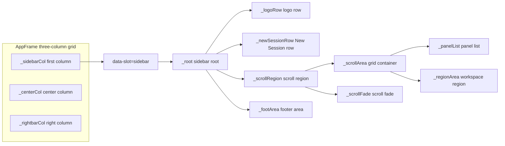
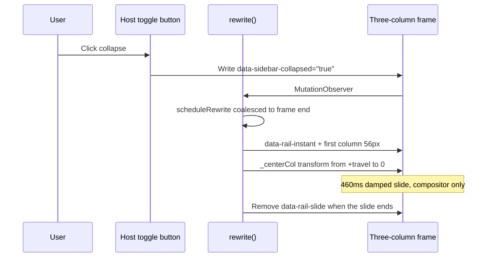
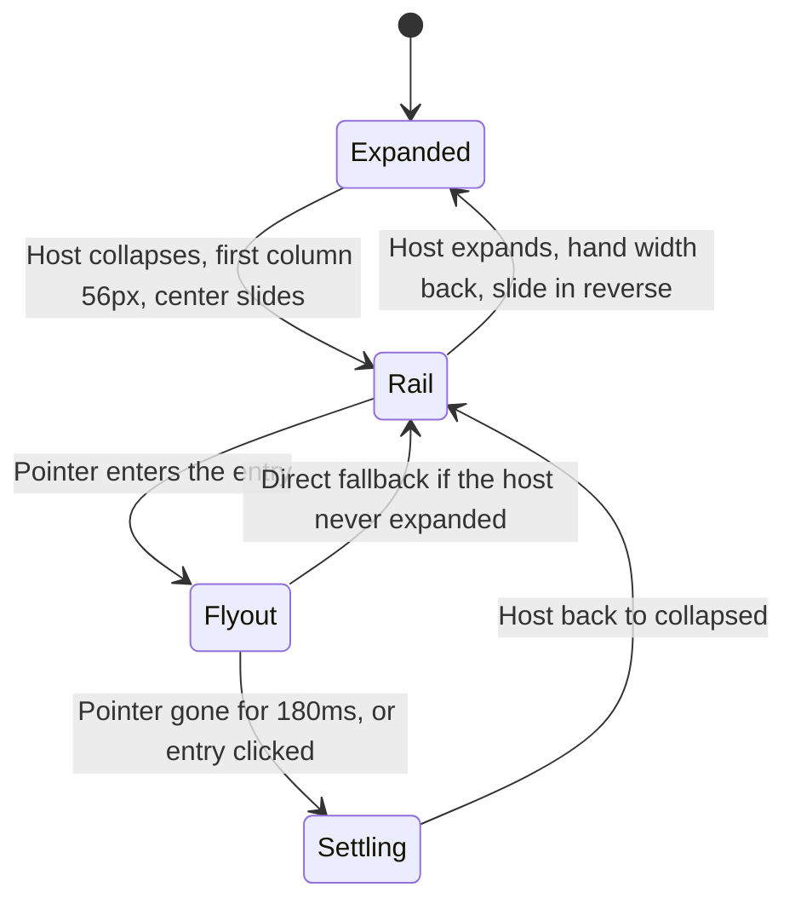

# Sidebar Icon Rail

[中文](README.md) | English

On the Windows desktop client, collapsing the sidebar makes the layout compute the first column as `0px`, so the whole column disappears. This plugin restores that column as a 56px vertical icon rail, keeping the panels, New Session, the workspace entry and the two footer rows clickable while collapsed. The workspace entry replaces the original search box with a folder icon, and hovering it floats a workspace session card out to the right of the rail. Since 1.1.0 the plugin also registers a "Sidebar settings" section in Settings, where the sidebar background color, the text/icon color, and which icons the collapsed rail shows can be customized.

## Install

This plugin targets the Windows desktop client (titlebar mode), whose profile is named `desktop`. First enable the `dsh` command from the desktop app's **Application** menu via **Manage dsh Command** (the `desktop` profile is managed exclusively by the Electron app, and only the `dsh` command installed this way can operate on it), then run:

```sh
dsh plugin --profile desktop add github:uitTe/dsh-sidebar-restore
```

Restart the desktop app afterwards and collapse the sidebar to see the rail. The host half does nothing; everything happens in the browser client, and the plugin makes no network requests.

## Sidebar settings (1.1.0)

The plugin registers a **Sidebar settings** section in the Settings sidebar through the official `settings.section` slot (id `sidebar-restore`), the same mechanism other plugins use for their own sections; its labels follow the UI language (Chinese / English). Every setting is stored in `localStorage`, applies immediately, survives reloads, and a **Reset all to defaults** button at the bottom of the section clears everything at once:

- **Color schemes**: four presets at the top of the section apply a background color, a text/icon color and an opacity in one click — Punk Neon (deep purple `#160a2e` / cyan `#00e5ff` / 85%), Neon Pink-Blue (punk blue `#0a1638` / pink `#ff2ea6` / 88%), Midnight Blue (`#111827` / `#e5e7eb` / 94%) and Warm Paper (`#fdf6e3` / `#3f3f46` / 100%). Each value can still be fine-tuned individually afterwards.
- **Background color** (key `dsh-sidebar-restore:sidebar-bg`): 10 preset swatches (the first follows the theme), a color picker, a hex input and a per-group reset. It applies to the docked sidebar, the collapsed rail and the workspace flyout card alike. Below it, a **background opacity** slider (key `dsh-sidebar-restore:sidebar-bg-alpha`, 0–100%) fades the sidebar and the card together, so a custom wallpaper can show through; resetting the background group also returns opacity to 100%.
- **Text & icon color** (key `dsh-sidebar-restore:sidebar-fg`): an independent second color group. The whole column's text and icons change together, secondary text is automatically dimmed one step to preserve hierarchy, and the New Session button's fill switches to a tint of the custom color so nothing becomes unreadable (no white-on-white or light-on-dark clashes).
- **Minimal rail**: a **Minimal rail** toggle (key `dsh-sidebar-restore:minimal-rail`) keeps only the whale logo, New Session, the workspace entry and the account avatar in the collapsed rail, hiding the whole panel section in between. Below it, a **Hide individual icons** list is built dynamically from the panels actually present in the current sidebar, one checkbox per panel (key `dsh-sidebar-restore:hidden-panels`); checked panels are hidden only while collapsed, never while docked.

## How the host behaves, and where this plugin sits

The DSH desktop UI is assembled from several client plugins. This plugin sits outside them and changes the collapsed appearance purely by overriding styles and rewriting the frame's column widths; it replaces no host component.



The three column widths come from `AppFrame`'s inline style: `gridTemplateColumns: "${cols.sidebar}px minmax(...) 1fr ..."`. The host computes the collapsed width as `const collapsedWidth = drawer || darwin || windowsTitlebar ? 0 : 56;` — the Windows desktop client and drawer mode both land on `0`.

The sidebar root's class follows `wide`. When collapsed in Windows titlebar mode, the host changes this subtree in four places:

| Host change | Location | Plugin countermeasure |
| --- | --- | --- |
| `_panelList`, `_regionArea`, `_footArea` get `display: none` as whole blocks | Sidebar stylesheet, collapsed rules | Show them again inside the rail, laid out as a column |
| `_newSession` becomes `position: fixed` and floats into the titlebar | Sidebar stylesheet, collapsed rules | Back to `position: static`, restored to the top of the rail |
| `_logoRow` height is zeroed | Sidebar stylesheet, collapsed rules | Kept zeroed; the logo is generated by the root's `::before` instead |
| Workspace list content only renders while `wide` | `WorkspaceBrowser`'s `listArea` | During hover, let the host enter the expanded state and float the card right of the rail |

None of these values are exposed through Config, slot props or `ctx.layout`, so style overrides plus column-width rewriting are the only way in.

## Files

| File | Role |
| --- | --- |
| `package.json` | Package name `@uitte/dsh-sidebar-restore`; `dsh.bundle.patch` points at `cordis.patch.yml`; `dsh.client` declares `platform: "web"`, `immediately: true` |
| `cordis.patch.yml` | Inserts one bundle entry with `id: sidebar-rail` |
| `index.js` | Host half: only an empty `export function apply() {}` |
| `client.js` | All behavior: style injection, column rewriting, slide animation, entry button, flyout card, settings section |
| `locale/zh.json`, `locale/en.json` | The plugin's title and description on the settings page |
| `icon.svg` | 48 × 48 rail pictogram |

`client.js` registers through `window.__ModuleLoader__.load({ id, factory() { ... } })` and returns `inject: ['layout', 'slots']` (`slots` was added in 1.1.0 to register the settings section). Inside `apply(ctx)`, all side effects are wrapped in `ctx.effect(fn, 'sidebar-rail')`; the returned cleanup removes the styles, the button, the observers and the attributes written on `html` and the frame.

## Constants

| Name | Value | Meaning |
| --- | --- | --- |
| `RAIL` | `56` | Rail width |
| `RAIL_TRACK` | `"56px"` | Value written into the first column track |
| `DEFAULT_EXPANDED` | `280` | Estimated expanded width when mounted already-collapsed |
| `BUTTON` | `36` | Button edge length inside the rail |
| `ICON` | `18` | Icon edge length inside the rail |
| `FISH_W` / `FISH_H` | `48.84` / `36.63` | Whale ink size inside `favicon.svg`'s 50 × 50 canvas |
| `LOGO_W` / `LOGO_H` | `18` / `36` | Logo box width and height |
| `LOGO_MASK` | `18.43` | Mask canvas scale so the ink is exactly 18px wide |
| `SLIDE_MS` | `460` | `transform` slide duration |
| `SLIDE_EASING` | `cubic-bezier(0.32, 1.24, 0.46, 1)` | Damped curve with slight overshoot |
| `FLYOUT_W` | `280` | Card width |
| `FLYOUT_LINGER_MS` | `180` | Delay before the card closes after the pointer leaves |
| `FOLDER_PATH` | 16 × 16 path | Same path data as the host's `folder-close` icon |

`RAIL_STATE` is the selector shared by the collapsed, flyout and settling states:

```
:is([data-sidebar-collapsed="true"], [data-rail-flyout], [data-rail-settling])
```

## Style layer

All styles live in one template string, injected as `<style data-plugin="@uitte/dsh-sidebar-restore">`; any older node with the same name is removed before mounting, so reloading never stacks two copies.

Every rail rule starts with `html[data-windows-titlebar]` plus `RAIL_STATE` and follows the full hierarchy `> [class*="_sidebarCol"] > [data-slot="sidebar"] > [class*="_root"]`. The full path matters: the `_root` suffix is reused by several packages inside the same sidebar, and a bare `[class*="_root"]` would also match other packages' roots inside the panel list.

What each group does:

- **Freeze**: in the flyout and settling states, transitions and animations on the frame, `_centerCol` and the `_sidebarCol` subtree are disabled and the sidebar content's opacity is pinned to `1`, so the host flipping class names back and forth doesn't flash the whole column.
- **Neutralize entrance animations**: the host plays `rail-in` when entering the collapsed state, `wide-in` in the wide state and `fading` on fade-out, all starting from `opacity: 0`. Inside the rail these animations are disabled and opacity/`transform` are reset, otherwise opening or closing the card would re-trigger a full-column fade-in.
- **Rail container**: `padding: 8px 0 6px`, `align-items: center`, width `56px` with `min-width` and `max-width` set to the same value.
- **Product logo**: the root's `::before` generates an 18 × 36 box using `favicon.svg` as a `mask-image`, scaled to `18.43px`, colored with `--dsw-alias-label-primary` so it follows light/dark themes automatically.
- **New Session**: `position: static`, 36 × 36, no background or border, 16px icon (the host passes the 14/16 tier for New Session).
- **Panel list and footer**: `display: flex` column, `gap: 0`, `row-gap: 0`, full width, horizontally centered, no gaps between icons.
- **Footer rows**: the settings row is compressed into a 36px square button with `_triggerLabel` and the status indicator hidden; the plugin action row becomes a 36px round badge with `_badgeLabel` and `_badgeCount` hidden.
- **Icon sizes**: the host passes 16 in the wide state and 18 in the rail state; while the card is open the host is in the wide state and would shrink every icon one step, so the rail sizes are written back per location (`_panelGlyph svg`, `button[class*="_newSession"] [class*="_newSessionContent"] svg`, `_trigger svg`, `_badge svg`).
- **Hidden text**: `_panelTitle`, `_newSessionLabel`, `_newSessionShortcut` and `_brandName` don't fit a 56px strip and are collapsed away.
- **Workspace region hidden in the rail**: under `:not([data-rail-flyout])` the whole block is `display: none`. The host gives it `flex: 1`; leaving it in would push the footer rows up when the card floats.
- **Card**: in the flyout state both `_sidebarCol` and the root allow overflow, the root stays 56px wide and gains `position: relative`; `_regionArea` becomes absolutely positioned with `left: 56px`, `top: var(--rail-flyout-top, 8px)`, width 280px, rounded corners, shadow and `z-index: 80`, restoring the expanded layout inside (the workspace header row and the stock search are fully restored in the card since 1.0.9).
- **Details**: the menu origin is pinned to `--dsh-windows-menu-start: 48px` in the collapsed and flyout states, and the 0.5px divider between rail and center column is restored (the host drops this border in the titlebar branch).

Class names carry build hashes, so everything is located by `[class*="_xxx"]` substrings. Same-prefix class names must be excluded explicitly — this has bitten twice: `_newSessionLabel` also matches `_newSessionLabelMask` (which wraps both icon and label; hiding it eats the icon too), `_panelTitle` also matches `_panelTitleBlock`, and `_badge` also matches `_badgeLabel` and `_badgeCount`.

## Animation

The host's own collapse/expand is a `transition: grid-template-columns`. That property re-allocates all three column widths and re-lays-out everything in both side columns on every frame — expensive, and the longer the duration, the more frames and the more visible the jank. This plugin does it in two steps instead:

1. The column width jumps straight to its final value; the frame gets `data-rail-instant` for the writing frame, disabling the host's column transition so the browser lays out exactly once.
2. A `transform` animation on `_centerCol` slides it from the old position to the final one, compositor-only, never triggering layout.

Duration and the damping curve both live on that `transform`, which is what allows 460ms with a slight overshoot. During the slide the frame carries `data-rail-slide` and `_centerCol` gets `will-change: transform`.



## State machine



On the frame, state is expressed through four attributes:

| Attribute | Written by | Meaning |
| --- | --- | --- |
| `data-sidebar-collapsed="true"` | Host | Collapsed state |
| `data-rail-flyout` | Plugin | Flyout card open |
| `data-rail-settling` | Plugin | Card closed, waiting for the host to return to collapsed |
| `data-rail-instant` | Plugin | Column transition disabled for two frames |

Variables maintained inside the script:

| Variable | Role |
| --- | --- |
| `frame` | The bound three-column frame |
| `rail` | Previous rail state, used to detect collapse/expand switches |
| `expanded` | Most recent expanded column width; slide distance is its difference from `RAIL` |
| `slide` | The running `transform` animation |
| `instantFrame` | Frame handle that removes `data-rail-instant` |
| `flyout` | Whether the card is open |
| `expandedByFlyout` | The sidebar was expanded by the plugin and must be restored on close |
| `lingerTimer` | Delay handle for closing the card |
| `positionFrame` | Frame handle for recomputing the entry position and card top |
| `settling` | Whether the close transition is still running |
| `hoverClosed` | After a click-close, don't hover-open again until the pointer leaves the entry |
| `rewriteFrame` | Frame handle coalescing rewrites |

`rewrite()` is the only place column widths are written, with three branches by state:

- **Locked branch** (`flyout || settling`): pin `rail` true, write the first column as `56px` and `--dsh-windows-sidebar-width` as `56px`; when the host returns to collapsed, remove `data-rail-settling`. This branch only ever writes `56px` and never slides, so the center column doesn't move at all while the card opens and closes.
- **Rail branch** (`active` true): on the switch, write `56px` and slide forward by `expanded - RAIL`; if already on the rail but the first column was written as `0px`, rewrite the width only, without sliding.
- **Expanded branch** (`active` false): on the switch, slide in reverse; if the first column is still `56px`, hand it back to the host (which writes `0px`); also record the current width as the next slide distance.

The frame's `style` attribute, `data-sidebar-collapsed` and `data-sidebar-drawer` are watched by `frameObserver`, and every callback goes through `scheduleRewrite()` to coalesce into the next frame. Rewriting synchronously would form a "write styles → observer callback → write again" self-exciting loop that saturates the main thread with microtasks and visibly freezes the UI. The same discipline applies to writes: compare before writing, and skip the write when the value hasn't changed.

## Entry button and flyout card

The entry button is a `button[data-rail-workspace-button]` holding a 16 × 16 folder icon, with `aria-label` and `title` both "Workspace". `mountEntry()` inserts it into the sidebar root, right before the workspace region, so it takes part in the normal layout like the panel icons:

- `display: none` by default; only `display: inline-flex` while `html[data-rail-workspace]` is present;
- 36 × 36, `margin: 0`, `padding: 0`, `border: none`, `appearance: none`, centered both ways;
- 18 × 18 icon, same size as the other rail icons;
- The mount target comes from `document.querySelector('[data-slot="sidebar"] > [class*="_root"]')`. The slot container is a `display: contents` anchor and the sidebar root is its direct child.

Before each mount, any other buttons of the same kind left in the page are removed, so stale nodes from a hot reload never coexist with the new one.

Hover opening is decided by pointer position, not `pointerenter`. The entry button lives inside the host's sidebar root; when the host re-renders, the button is re-inserted in place, and re-insertion re-dispatches `pointerover` under the pointer. Using that as the open condition would self-excite into an "open → host re-render → re-insert → open again" loop. `onPointerMove` uses `pointerInside()` to test whether the pointer is inside the entry rect or the card rect; a hit cancels the close delay, otherwise the 180ms delay starts.

The card's position is not hard-coded: on every frame, `syncFlyoutTop()` (inside `schedulePosition()`) compares the entry's top edge with the root's top edge and writes the difference into `--rail-flyout-top`, so the card's vertical start follows the entry.

The order inside `openFlyout()` matters: cancel any running slide, set `flyout`, add `data-rail-flyout`, remove `data-rail-settling`, `holdInstant()` to kill transitions, mark `expandedByFlyout`, and only then call `ctx.layout.toggleSidebar()` so the host enters the expanded state and renders the workspace list. In the reverse order the host would first render the wide state and then be pulled back by the plugin, and that intermediate frame is a visible jump.

`closeFlyout()` only removes `data-rail-flyout` and adds `data-rail-settling`; rail styling keeps being covered by the settling state in `RAIL_STATE` until `rewrite()` observes that the host is back to collapsed and removes `data-rail-settling`. The settling state exists because between removing `data-rail-flyout` and the host finishing its re-render there are one or two frames that are neither collapsed nor flyout; without this cover, the sidebar would lay out in the expanded arrangement for those frames and the whole page would visibly snap back.

## Relationship to host state

Workspace list content only renders while the host's `wide` is true — the `wide` passed to `renderSlot('sidebar.workspaces', { wide, ... })` in `regionArea` comes straight from host state. So a hover expansion must really put the host into the expanded state before the card has anything to show. The cost: host state genuinely changes, and everything keyed on `wide` switches during the hover. The plugin's approach is to keep the collapsed class names in force — `railActive()` only honors `data-sidebar-collapsed="true"`, an attribute owned by host state that the plugin cannot change; what it can do is keep "the whole collapsed rule set in effect", by having `RAIL_STATE` also count `data-rail-flyout` and `data-rail-settling` as rail states, so the host's collapsed rules and the plugin's overrides keep applying to the root subtree.

## Test bench

`tmp-verify/` holds a headless-Chrome + CDP reproduction bench that reads computed styles and geometry without a real machine:

| File | Role |
| --- | --- |
| `serve.mjs` | Static server on port 4399 |
| `fixture.html` | Sidebar DOM replicated from the host structure, with wide/collapsed class switching |
| `client.js` | A copy taken from the plugin directory |
| `probe.mjs` | Full probe: rail stability, flyout geometry, click jank, column-write sequences |
| `probe-entry.mjs` | Per-state entry button visibility and size |
| `render-css.mjs` | Renders the plugin style template with constants substituted into `plugin.css` for line-by-line review |
| `count-tokens.mjs` | Counts keyword hits and prints context snippets |
| `slice.mjs` | Slices file fragments by character offset |
| `list-asar.mjs` | Lists `app.asar` entries by keyword |
| `scan-asar-text.mjs` | Scans text inside `app.asar` by keyword |
| `extract-asar.mjs` | Extracts files from `app.asar` |

To re-run:

```
node tmp-verify/probe.mjs http://127.0.0.1:4399/ 9411
node tmp-verify/probe-entry.mjs http://127.0.0.1:4399/ 9413
```

`probe-entry.mjs` needs `window.startRail()` first, then `window.host.mount()`.

Latest bench readings: the three-state rail signature has `deviationCount` `0`; the flyout card reads `cardLeft: 56`, `cardWidth: 280`, and `cardTop` equal to the entry's top edge at `188`; after collapsing, `columns: "56px minmax(400px, 1fr) minmax(0px, 0px)"`; across twenty-plus frames of hover-open and leave-close column sequences, every value is `56` and `0px` never appears.

