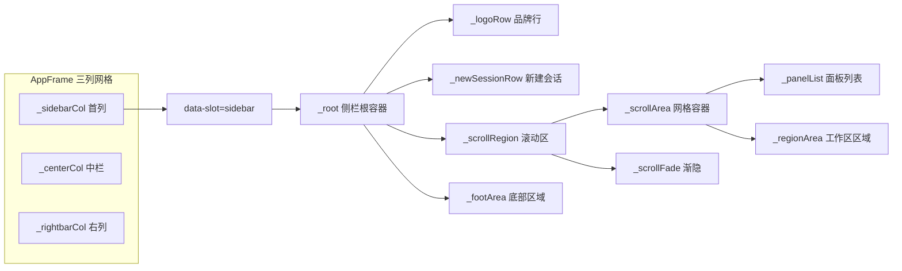
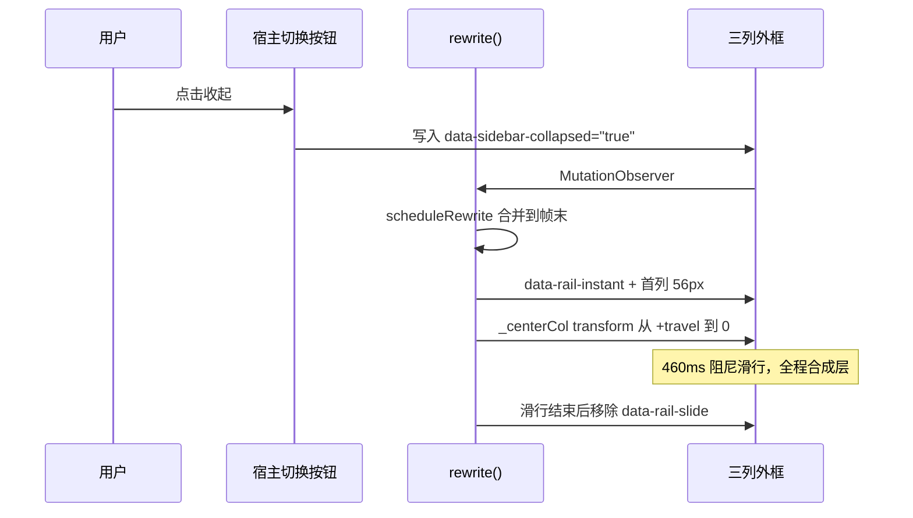
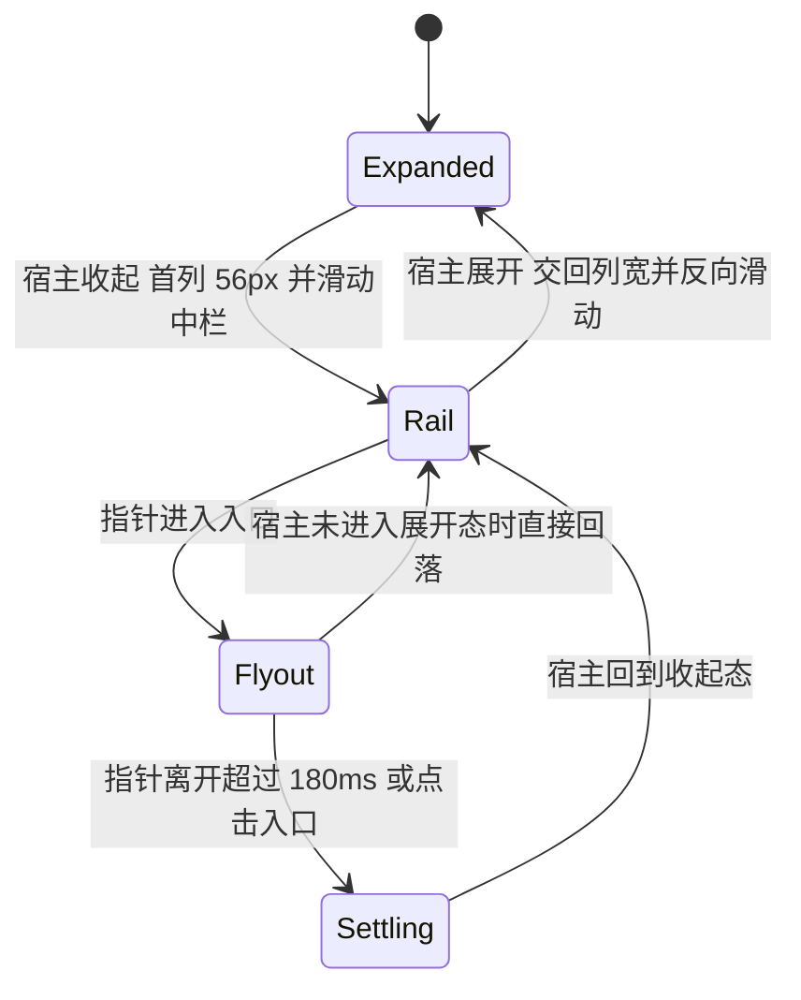

# 侧边栏图标轨道

Windows 桌面端收起侧边栏后，布局把首列轨道算成 `0px`，整列消失；本插件把这一列还原成 56px 图标竖条，让面板、新建会话、工作区入口与底部两行在收起态仍然可点。工作区入口用文件夹图标取代原来的搜索盒，指针悬停时在轨道右侧浮出一张工作区会话卡片。

## 安装

在 DeepSeek Harness 中执行（`web` 换成你实际使用的 profile 名）：

```sh
dsh plugin --profile web add github:uitTe/dsh-sidebar-rail
```

装好后重启 DSH，收起侧边栏即可看到轨道。本插件面向 Windows 桌面端（标题栏模式）；宿主侧无行为，全部效果在浏览器端完成，不发网络请求。

Install: run `dsh plugin --profile web add github:uitTe/dsh-sidebar-rail` in DeepSeek Harness, then restart. Windows desktop (titlebar mode) only.

## 宿主的行为与本插件的位置

DSH 桌面端的界面由若干客户端插件拼成，本插件挂在这些插件之外，通过覆盖样式与改写外框列宽改变收起态外观，不替换宿主组件。



三列宽度由 `AppFrame` 的内联样式给出：`gridTemplateColumns: "${cols.sidebar}px minmax(...) 1fr ..."`。宿主算首列宽度时用的是 `const collapsedWidth = drawer || darwin || windowsTitlebar ? 0 : 56;`，Windows 桌面端与抽屉模式都落到 `0`。

侧栏根容器的类名跟着 `wide` 走。Windows 标题栏模式收起时，宿主对这一段做四处改动：

| 宿主改动 | 位置 | 插件对策 |
| --- | --- | --- |
| `_panelList`、`_regionArea`、`_footArea` 整段 `display: none` | 侧栏样式表收起态规则 | 轨道内重新显示并按列排布 |
| `_newSession` 改成 `position: fixed` 飘进标题栏 | 侧栏样式表收起态规则 | 改回 `position: static` 并放回轨道顶部 |
| `_logoRow` 高度归零 | 侧栏样式表收起态规则 | 保留归零，标志改由根容器 `::before` 生成 |
| 工作区列表内容只在 `wide` 时渲染 | `WorkspaceBrowser` 的 `listArea` | 悬浮期间让宿主进入展开态，卡片再浮到轨道右侧 |

这些量都不经过 Config、槽位属性或 `ctx.layout` 暴露，因此只能用样式覆盖加列宽改写。

## 目录与清单

| 文件 | 作用 |
| --- | --- |
| `package.json` | 包名 `@local/dsh-sidebar-rail`，`dsh.bundle.patch` 指向 `cordis.patch.yml`，`dsh.client` 声明 `platform: "web"`、`immediately: true` |
| `cordis.patch.yml` | 在 bundle 里插入一条 `id: sidebar-rail` 的条目 |
| `index.js` | 宿主半，只有空的 `export function apply() {}` |
| `client.js` | 全部行为：样式注入、列宽改写、滑动动画、入口按钮、悬浮卡片 |
| `locale/zh.json`、`locale/en.json` | 插件在设置页的标题与描述 |
| `icon.svg` | 48 × 48 的轨道示意图标 |

`client.js` 以 `window.__ModuleLoader__.load({ id, factory() { ... } })` 注册，返回值声明 `inject: ['layout']`，`apply(ctx)` 里用 `ctx.effect(fn, 'sidebar-rail')` 包住全部副作用，返回的清理函数负责摘掉样式、按钮、观察器与写在 `html`、外框上的属性。

## 常量

| 名称 | 值 | 含义 |
| --- | --- | --- |
| `RAIL` | `56` | 轨道宽度 |
| `RAIL_TRACK` | `"56px"` | 写进首列轨道的值 |
| `DEFAULT_EXPANDED` | `280` | 挂载时已收起状态下的展开宽估计值 |
| `BUTTON` | `36` | 轨道内按钮边长 |
| `ICON` | `18` | 轨道内图标边长 |
| `FISH_W` / `FISH_H` | `48.84` / `36.63` | `favicon.svg` 的 50 × 50 画布里鲸鱼墨迹的尺寸 |
| `LOGO_W` / `LOGO_H` | `18` / `36` | 标志盒宽度与高度 |
| `LOGO_MASK` | `18.43` | 遮罩画布缩放，使墨迹正好 18px 宽 |
| `SLIDE_MS` | `460` | `transform` 滑动时长 |
| `SLIDE_EASING` | `cubic-bezier(0.32, 1.24, 0.46, 1)` | 带越冲的阻尼曲线 |
| `FLYOUT_W` | `280` | 卡片宽度 |
| `FLYOUT_LINGER_MS` | `180` | 指针离开后收起卡片的延迟 |
| `FOLDER_PATH` | 16 × 16 路径 | 与宿主 `folder-close` 图标同一份路径 |

`RAIL_STATE` 是收起态、悬浮态、收起过渡态共用的选择器：

```
:is([data-sidebar-collapsed="true"], [data-rail-flyout], [data-rail-settling])
```

## 样式层

样式集中在一段模板字符串里，注入为 `<style data-plugin="@local/dsh-sidebar-rail">`，挂载前先删掉同名的旧节点，重复加载不会叠出两份。

轨道外观的所有规则都以 `html[data-windows-titlebar]` 加 `RAIL_STATE` 起头，并沿着 `> [class*="_sidebarCol"] > [data-slot="sidebar"] > [class*="_root"]` 的完整层级书写。层级必须写全：`_root` 这个后缀在同一条侧栏里被多个包复用，只写 `[class*="_root"]` 会连带命中面板列表里其它包的根节点。

各段的职责：

- **冻结**：悬浮态与过渡态下关掉外框、`_centerCol`、`_sidebarCol` 子树的过渡与动画，并把侧栏内容的不透明度压到 `1`，避免宿主来回切换类名时整列闪一下。
- **中和入场动画**：宿主在收起态入场播 `rail-in`，在宽态播 `wide-in`，淡出时播 `fading`，三组关键帧都从 `opacity: 0` 起。轨道内把这些动画一并关掉并把不透明度、`transform` 复位，否则卡片开合会重新触发整列透明再浮现。
- **轨道容器**：`padding: 8px 0 6px`、`align-items: center`，宽度 `56px`，`min-width`、`max-width` 同值。
- **产品标志**：根容器 `::before` 生成 18 × 36 的盒子，用 `favicon.svg` 做 `mask-image`，遮罩缩放到 `18.43px`，颜色取 `--dsw-alias-label-primary`，深浅色主题自动跟随。
- **新建会话**：`position: static`、36 × 36、无底色无边框、图标 16px（宿主给新建会话传的就是 14/16 这一档）。
- **面板列表与底部区域**：`display: flex` 列向、`gap: 0`、`row-gap: 0`、宽度满格、水平居中，图标之间不留间隔。
- **底部两行**：设置行压成 36px 方形按钮，隐藏 `_triggerLabel` 与状态指示；插件动作行压成 36px 圆形徽标，隐藏 `_badgeLabel` 与 `_badgeCount`。
- **图标尺寸**：宿主按宽态、轨道态分别传 16 与 18，卡片展开期间宿主处于宽态会把图标整体缩小一圈，这里按 `_panelGlyph svg`、`button[class*="_newSession"] [class*="_newSessionContent"] svg`、`_trigger svg`、`_badge svg` 逐处写回轨道态尺寸。
- **文字隐藏**：`_panelTitle`、`_newSessionLabel`、`_newSessionShortcut`、`_brandName` 在 56px 竖条里放不下，收起。
- **轨道里隐藏工作区区域**：`:not([data-rail-flyout])` 下整段 `display: none`。宿主给这一段设了 `flex: 1`，留着会在卡片浮起时把底部两行顶上去。
- **卡片**：悬浮态下 `_sidebarCol` 与根容器都放开溢出，根容器保持 56px 宽并加 `position: relative`；`_regionArea` 改成绝对定位，`left: 56px`、`top: var(--rail-flyout-top, 8px)`、宽 280px、圆角、阴影、`z-index: 80`，内部恢复展开排布并隐藏卡片里的搜索盒。
- **细节**：菜单起点在收起态与悬浮期固定 `--dsh-windows-menu-start: 48px`；轨道与中栏之间补回 0.5px 分隔线，宿主在标题栏分支去掉了这条边框。

类名带构建哈希，只能按 `[class*="_xxx"]` 子串定位。同前缀的类名要显式排除，已经踩过两次：`_newSessionLabel` 会连带命中 `_newSessionLabelMask`（图标与标签都包在那层里，隐藏它会把图标一起吃掉），`_panelTitle` 会连带命中 `_panelTitleBlock`，`_badge` 会连带命中 `_badgeLabel` 与 `_badgeCount`。

## 动画

宿主自己的收起与展开是 `transition: grid-template-columns`。这个属性每帧都要重新分配三列宽度，并把两侧列内全部内容重新排版，帧成本很高；时长越长要跑的帧越多，卡顿越明显。本插件改成两步：

1. 列宽当场跳到终值，写入那一帧给外框加 `data-rail-instant`，关掉宿主列宽过渡，浏览器只做一次布局；
2. 用 `_centerCol` 上的一条 `transform` 动画从旧位置滑到终点，只走合成层，不触发布局。

时长与阻尼曲线都作用在这条 `transform` 上，因此能拉到 460ms 并带轻微越冲。滑动期间外框加 `data-rail-slide`，`_centerCol` 设 `will-change: transform`。



## 状态机



对外框而言，状态体现在四个属性上：

| 属性 | 写入方 | 含义 |
| --- | --- | --- |
| `data-sidebar-collapsed="true"` | 宿主 | 收起态 |
| `data-rail-flyout` | 插件 | 悬浮卡片展开中 |
| `data-rail-settling` | 插件 | 卡片已收起，等宿主回到收起态 |
| `data-rail-instant` | 插件 | 两帧内关掉列宽过渡 |

脚本内部维护的变量：

| 变量 | 作用 |
| --- | --- |
| `frame` | 已绑定的三列外框 |
| `rail` | 上一次的轨道状态，用来识别收起与展开的切换 |
| `expanded` | 最近一次展开态列宽，滑动距离由它与 `RAIL` 的差值决定 |
| `slide` | 进行中的 `transform` 动画 |
| `instantFrame` | 解除 `data-rail-instant` 的帧句柄 |
| `flyout` | 卡片是否展开 |
| `expandedByFlyout` | 侧栏是被插件撑开的，收起时要还原 |
| `lingerTimer` | 收起卡片的延迟句柄 |
| `positionFrame` | 重新计算入口位置与卡片起点的帧句柄 |
| `settling` | 收起过渡是否还在进行 |
| `hoverClosed` | 点击收起后指针未离开入口前不再悬停展开 |
| `rewriteFrame` | 合并改写的帧句柄 |

`rewrite()` 是唯一的列宽写入点，按当前状态分三支：

- **锁定支**（`flyout || settling`）：把 `rail` 置真，首列固定写 `56px`，`--dsh-windows-sidebar-width` 写 `56px`，宿主回到收起态时摘掉 `data-rail-settling`。这一支只写 `56px` 且不起滑动，卡片开合期间中栏位置完全不动。
- **轨道支**（`active` 为真）：刚切换过来时写 `56px` 并正向滑动一段 `expanded - RAIL`；已经在轨道上但首列被写成 `0px` 时只补写列宽，不滑动。
- **展开支**（`active` 为假）：刚切换过来时反向滑动一段；首列仍是 `56px` 时交回宿主写 `0px`；顺手记下当前列宽作为下次的滑动距离。

宿主外框的 `style` 属性、`data-sidebar-collapsed`、`data-sidebar-drawer` 由 `frameObserver` 观察，回调一律走 `scheduleRewrite()` 合并到下一帧。直接同步改写会形成「改写样式 → 观察回调 → 再改写」的自激链，主线程被微任务占满，界面表现为卡死。同一条纪律也落在写入判断上：每次写属性前先比值，值没变就不写。

## 入口按钮与悬浮卡片

入口按钮是一个 `button[data-rail-workspace-button]`，内含 16 × 16 的文件夹图标，`aria-label` 与 `title` 都是「工作区」。它由 `mountEntry()` 插到侧栏根容器里、工作区区域之前，因此和面板图标一样参与正常排布：

- `display: none` 为默认值，`html[data-rail-workspace]` 在场时才 `display: inline-flex`；
- 36 × 36、`margin: 0`、`padding: 0`、`border: none`、`appearance: none`、水平垂直居中；
- 图标 18 × 18，与其它轨道图标同尺寸；
- 挂载目标由 `document.querySelector('[data-slot="sidebar"] > [class*="_root"]')` 得到。槽位容器是 `display: contents` 的锚点，侧栏根元素是它的直接子节点。

每次挂载前先清掉页面里其它同类按钮，热更新留下的旧节点不会与新节点并存。

悬停展开由指针位置判定，不用 `pointerenter`。入口按钮挂在宿主的侧栏根容器里，宿主重渲染后会被重新插回原位置，重新插入会在指针下重新派发 `pointerover`；若以它作为展开条件，「展开 → 宿主重渲染 → 重新插入 → 再次展开」会自激成死循环。`onPointerMove` 用 `pointerInside()` 分别判断指针是否落在入口矩形或卡片矩形内，命中就取消收起延迟，否则启动 180ms 延迟。

卡片的位置不写死：`syncFlyoutTop()` 在每帧的 `schedulePosition()` 里比较入口上缘与根容器上缘，把差值写进 `--rail-flyout-top`，卡片纵向起点随入口移动。

`openFlyout()` 的顺序是有讲究的：先取消进行中的滑动，置 `flyout`，加 `data-rail-flyout`，摘掉 `data-rail-settling`，`holdInstant()` 关掉过渡，标记 `expandedByFlyout`，最后才调 `ctx.layout.toggleSidebar()` 让宿主进入展开态并渲染工作区列表。顺序反过来，宿主会先渲染出宽态再被插件收回，中间那一帧就是可见的跳变。

`closeFlyout()` 只摘 `data-rail-flyout` 并加上 `data-rail-settling`，轨道样式继续由 `RAIL_STATE` 里的过渡态兜住，直到 `rewrite()` 观察到宿主已经回到收起态才摘掉 `data-rail-settling`。过渡态存在的原因：摘下 `data-rail-flyout` 到宿主重新渲染完成之间有一到两帧既不是收起态也不是悬浮态，没有这个兜底，那两帧里侧栏会按展开态排版，表现为整页回弹。

## 与宿主状态的关系

工作区列表的内容只在宿主 `wide` 为真时渲染，`regionArea` 里 `renderSlot('sidebar.workspaces', { wide, ... })` 的 `wide` 直接来自宿主状态。因此悬浮展开必须让宿主真的进入展开态，卡片才有内容可放。这条依赖带来一个代价：宿主的状态确实变了，凡是跟着 `wide` 走的样式都会在悬浮期间切开。插件的做法是让收起类名继续在场——`railActive()` 只认 `data-sidebar-collapsed="true"`，这个属性由宿主的状态决定，插件改不了它；能改的是「收起态那一整套规则继续生效」，即靠 `RAIL_STATE` 把 `data-rail-flyout`、`data-rail-settling` 也算作轨道态，让宿主的收起类名规则与插件的覆盖继续作用于根容器子树。

## 验证台

`tmp-verify/` 下是一套无头 Chrome 加 CDP 的复现台，用来读取计算样式与几何，不依赖真机：

| 文件 | 作用 |
| --- | --- |
| `serve.mjs` | 4399 端口的静态服务 |
| `fixture.html` | 按宿主结构复刻的侧栏 DOM，含宽态与收起态两套类名切换 |
| `client.js` | 从插件目录复制的副本 |
| `probe.mjs` | 全量探针：轨道稳定性、悬浮卡片几何、点击卡顿、列宽写入序列 |
| `probe-entry.mjs` | 逐状态读取入口按钮的可见性与尺寸 |
| `render-css.mjs` | 把插件样式模板按常量替换后写成 `plugin.css`，便于逐条核对 |
| `count-tokens.mjs` | 按关键词统计命中次数并打印上下文片段 |
| `slice.mjs` | 按字符偏移截取文件片段 |
| `list-asar.mjs` | 按关键词列出 `app.asar` 条目 |
| `scan-asar-text.mjs` | 在 `app.asar` 内按关键词扫描文本 |
| `extract-asar.mjs` | 从 `app.asar` 提取文件 |

复跑方式：

```
node tmp-verify/probe.mjs http://127.0.0.1:4399/ 9411
node tmp-verify/probe-entry.mjs http://127.0.0.1:4399/ 9413
```

`probe-entry.mjs` 需要先执行 `window.startRail()` 再执行 `window.host.mount()`。

最近一轮验证台读数：轨道三态签名 `deviationCount` 为 `0`；悬浮卡片 `cardLeft: 56`、`cardWidth: 280`、`cardTop` 与入口上缘同为 `188`；收起后 `columns: "56px minmax(400px, 1fr) minmax(0px, 0px)"`；悬停展开与离开收起两段各二十余帧的列宽序列里全都是 `56`，没有出现过 `0px`。

## 现有问题

### 工作区入口在真机上从未挂载

真机控制台报错：

```
Uncaught NotFoundError: Failed to execute 'insertBefore' on 'Node': The node before which the new node is to be inserted is not a child of this node.
    at mountEntry (dsh-app://app/plugins/@@local/dsh-sidebar-rail/client.js:674:1)
    at MutationObserver.<anonymous> (dsh-app://app/plugins/@@local/dsh-sidebar-rail/client.js:866:37)
```

`mountEntry()` 里 `root.insertBefore(entry, region)` 的参照节点 `region` 来自 `root.querySelector('[class*="_regionArea"]')`，这是深度后代查询；而宿主侧栏根容器 `div._root` 的直属子节点顺序是 `_logoRow` → `_newSessionRow` → `_scrollRegion` → `_scrollArea` → `_panelList` → `_scrollFade` → `_footArea`，`_regionArea` 实际在 `_scrollRegion > _scrollArea` 内部。把深度后代交给 `insertBefore` 作参照节点，浏览器直接抛 `NotFoundError`，按钮从未进入侧栏，收起后自然看不到工作区图标。

同一处层级错配还有第二处：`client.js:435` 的卡片定位选择器写成 `… > [class*="_root"] > [class*="_regionArea"]`，要求 `_regionArea` 是根容器的直接子节点，同样匹配不到，卡片的位置规则也一并失效。

修复方向：`mountEntry()` 改用 `region.parentElement.insertBefore(entry, region)`，插入后入口与 `_regionArea` 成为兄弟节点；卡片选择器去掉那一层 `>`，改成 `… > [class*="_root"] [class*="_regionArea"]`，并确认特异性仍高于上方轨道态的 100% 宽度规则。若要让入口排在 `_regionArea` 之前且仍处于根容器的直接子层级，需要把入口插到 `_scrollRegion` 之前，此时卡片定位基准也要跟着换。

### 验证台与真机结构不一致

`tmp-verify/fixture.html` 把 `_regionArea` 建成根容器的直接子节点，与宿主真实层级差一层。因此 `probe.mjs`、`probe-entry.mjs` 全部通过（`entryCount: 1`、`entryDisplay: "flex"`、`cardLeft: 56`、`cardWidth: 280`），真机却抛错。复现台需要通过真实层级才能守住这类问题，改动时应先按 `src_client_SidebarRoot.tsx` 的嵌套重建 `_scrollRegion > _scrollArea` 这一层。

### 真机取证通道缺失

桌面渲染进程走 `dsh-app://app/` 自定义协议，没有开放调试端口（`9222`、`19230` 的 `/json/version` 都返回 404）。Web GUI 端口对 `/` 返回 401，启动 Cookie 由主进程在 `host.start()` 之后用 `authenticateWebHost(url)` 取走并自行保管转发，外部构造不出来。`dsh` CLI 也不在 `PATH` 里。当前的取值方式是控制台报错加截图，逐帧数据只能靠复现台。

### 悬浮卡片依赖宿主展开态

卡片内容只在宿主 `wide` 为真时渲染，所以悬浮要真的调 `ctx.layout.toggleSidebar()`。宿主状态确实切过去了，凡是跟着 `wide` 走的量与插件覆盖没写到的地方都会在悬浮期间露出来。已经补上的有：面板标题、新建会话标签与快捷键、品牌名、底部两行文字与状态指示、图标尺寸、侧栏根容器宽度。这条依赖仍是这一块最脆的地方——宿主新增任何按 `wide` 渲染的东西，都要在插件的轨道态规则里补一条。

### 类名哈希耦合

选择器全部依赖 `[class*="_xxx"]` 子串，宿主升级后类名生成规则一变就会静默失配，表现为某些规则整体不生效，且没有报错。已经被前缀包含关系绊过三次（`_newSessionLabel` / `_newSessionLabelMask`、`_panelTitle` / `_panelTitleBlock`、`_badge` / `_badgeLabel`）。新增选择器时要先核对同前缀的更长类名。

### 图标尺寸由宿主属性决定

宿主按 `wide` 传 16 与 18，卡片展开期间处于宽态，图标会整体缩小一圈。插件只能事后用 CSS 写回轨道态尺寸，四处（面板、新建会话、头像、插件徽标）各有一条规则。宿主若改动这几处传值，`ICON`、`ICON - 2` 这些常量要跟着改。
